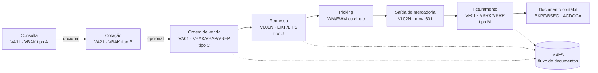
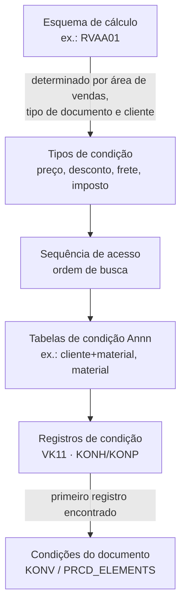

# SAP SD - Study

> Nível: prática
> Sales and Distribution: ordem de venda, remessa, faturamento, fluxo de documentos e determinação de preço.
> Relacionados: [SAP-Order-to-Cash-erp-study](https://github.com/igor-barral/SAP-Order-to-Cash-erp-study),
> [SAP-MM-erp-study](https://github.com/igor-barral/SAP-MM-erp-study), [SAP-FI-erp-study](https://github.com/igor-barral/SAP-FI-erp-study),
> [SAP-Enterprise-Structure-erp-study](https://github.com/igor-barral/SAP-Enterprise-Structure-erp-study),
> [SAP-Business-Partner-erp-study](https://github.com/igor-barral/SAP-Business-Partner-erp-study),
> [SAP-EWM-erp-study](https://github.com/igor-barral/SAP-EWM-erp-study).

## Objetivo

O SD cobre o lado comercial e de expedição: o que foi vendido, para quem, por qual preço, o que já saiu do
depósito e o que já foi faturado. É o módulo com mais relatórios e interfaces custom em projetos SAP no Brasil
(integração com e-commerce, força de vendas, transportadoras, emissão fiscal). Entender o fluxo de documentos e
a técnica de condições é pré-requisito para ler qualquer especificação de SD.

Ao concluir este estudo você deverá ser capaz de responder perguntas como:

- Como rastrear uma fatura até a ordem de origem?
- Onde entra a determinação de preço e como ela é configurada?
- Quais documentos o SD gera e em que tabelas cada um é gravado?
- O que é a área de vendas e por que ela aparece em quase todo cadastro de SD?
- O que mudou nas tabelas de SD do ECC para o S/4HANA?
- Em que momento o SD gera lançamento contábil?

## Ponte

| O que eu já conheço | Equivalente no SAP SD |
|---|---|
| Tabela `pedidos_venda` + `pedidos_venda_itens` | `VBAK` (cabeçalho) + `VBAP` (item) + `VBEP` (divisões) |
| Tabela `expedicoes` / `romaneios` | Remessa de saída: `LIKP` + `LIPS` |
| Tabela `faturas` / emissão de nota fiscal | Documento de faturamento: `VBRK` + `VBRP` (a nota fiscal brasileira é gerada a partir dele pela localização) |
| Colunas `pedido_origem_id` espalhadas pelas tabelas | Tabela única de fluxo de documentos: `VBFA` |
| Tabela de preços + regras de desconto em código (`if cliente vip...`) | Técnica de condições: tipos de condição, sequências de acesso, tabelas de condição e esquema de cálculo |
| Status calculado na hora (`pendente`, `parcial`, `faturado`) | Campos de status gravados por documento e por item |
| Cadastro de cliente com colunas por filial de venda | Business Partner com dados por área de vendas (`KNVV`) |

A técnica de condições é o ponto em que um desenvolvedor vindo de ERP próprio mais erra: a tentação é
calcular preço em ABAP. No SAP, preço, desconto, frete e imposto são configurados pelo funcional como
condições; código custom entra só em rotinas específicas (fórmulas e requisitos) quando a configuração não
basta.

## Conteúdo

### 1. Estrutura organizacional de vendas

- **Organização de vendas** (`VKORG`): unidade responsável pela venda, ligada a uma empresa (*company code*).
- **Canal de distribuição** (`VTWEG`): como o produto chega ao cliente (atacado, varejo, e-commerce).
- **Setor de atividade** (`SPART`): linha de produto.
- **Área de vendas** = organização de vendas + canal + setor. Cliente, preço e material de vendas são mantidos
  por área de vendas.
- **Local de expedição** (`VSTEL`): de onde a remessa sai; é determinado a partir do centro e de outros
  critérios configurados.

Detalhes em [SAP-Enterprise-Structure-erp-study](https://github.com/igor-barral/SAP-Enterprise-Structure-erp-study).

### 2. Fluxo de documentos



Cada documento de SD tem uma **categoria de documento** (`VBTYP`), que diz o que ele é, e um **tipo de
documento** configurável (ex.: `OR` para ordem padrão, `LF` para remessa, `F2` para fatura), que diz como ele
se comporta.

| Categoria (`VBTYP`) | Documento |
|---|---|
| `A` | Consulta |
| `B` | Cotação |
| `C` | Ordem |
| `G` | Contrato |
| `H` | Devolução |
| `K` | Solicitação de nota de crédito |
| `L` | Solicitação de nota de débito |
| `J` | Remessa |
| `M` | Fatura |
| `N` | Estorno de fatura |
| `O` | Nota de crédito |

No S/4HANA, o domínio da categoria foi ampliado; valores de um caractere ainda aparecem, mas confirme na SE11
antes de fixar valores em código.

### 3. Transações e tabelas

| Objeto | Criar / modificar / exibir | Tabelas | Observação |
|---|---|---|---|
| Cotação | `VA21` / `VA22` / `VA23` | `VBAK`, `VBAP` | Mesmas tabelas da ordem |
| Ordem de venda | `VA01` / `VA02` / `VA03` | `VBAK`, `VBAP`, `VBEP`, `VBKD` (dados comerciais), `VBPA` (parceiros) | `VBEP` = divisões (data e quantidade confirmadas) |
| Remessa de saída | `VL01N` / `VL02N` / `VL03N` | `LIKP`, `LIPS` | Picking e saída de mercadoria são feitos a partir dela |
| Lista de remessas a criar | `VL10` (e variantes) | - | Criação em massa de remessas |
| Faturamento | `VF01` / `VF02` / `VF03` | `VBRK`, `VBRP` | Gera o documento contábil |
| Lista de faturamento | `VF04` | - | Faturamento em massa |
| Estorno de fatura | `VF11` | `VBRK` | Gera documento de estorno |
| Registros de condição | `VK11` / `VK12` / `VK13` | `KONH`, `KONP` e tabelas `Annn` | Preços e descontos cadastrados |
| Condições do documento | aba de condições na ordem/fatura | ECC: `KONV` · S/4HANA: `PRCD_ELEMENTS` | Resultado do cálculo por documento |
| Cliente por área de vendas | `BP` (S/4HANA) · `XD01`/`VD01` (ECC) | `KNA1`, `KNVV`, `KNB1` | `KNB1` = dados por empresa (FI) |

### 4. Rastrear uma fatura até a ordem

A `VBFA` guarda, para cada documento, o documento anterior (`VBELV`, `POSNV`) e o seguinte (`VBELN`, `POSNN`),
com as categorias de cada um. Nas transações de exibição (`VA03`, `VL03N`, `VF03`), o botão "Fluxo de
documentos" mostra a árvore inteira.

Em código, a leitura direta ajuda a entender a estrutura (exemplo ilustrativo; em código novo no S/4HANA,
prefira as CDS views liberadas):

```abap
" Ordem de origem de uma fatura: procurar na VBFA o documento anterior do tipo ordem (C)
SELECT vbelv, posnv, vbeln, posnn, vbtyp_v
  FROM vbfa
  WHERE vbeln   = @lv_fatura
    AND vbtyp_v = 'C'
  INTO TABLE @DATA(lt_origem).
```

Na prática, a `VBFA` pode conter vários níveis (ordem → remessa → fatura), e a fatura referencia tanto a
remessa quanto a ordem conforme a configuração da cópia. Também existem campos de referência nos itens
(`VBRP-AUBEL` para a ordem, `VBRP-VGBEL` para o documento de referência, normalmente a remessa), que costumam ser
o caminho mais simples para um relatório.

### 5. Determinação de preço (técnica de condições)



- **Esquema de cálculo** (*pricing procedure*, transação de configuração `V/08`): a sequência de linhas do
  cálculo, com subtotais, condições obrigatórias e referências entre linhas.
- **Tipo de condição**: o que é calculado (preço, desconto, frete, imposto). Exemplo do padrão: `PR00`
  (preço). Os códigos variam por projeto e por localização; confirme no sistema.
- **Sequência de acesso**: em que ordem procurar o registro (primeiro preço específico do cliente, depois
  preço por lista, depois preço do material).
- **Tabela de condição** (`Annn`): a combinação de campos que forma a chave do registro.
- **Registro de condição**: o valor em si, com validade.
- **Requisitos e fórmulas** (rotinas `VOFM`): pontos em que o ABAP entra quando a configuração não resolve.
  No S/4HANA com Clean Core, verifique se há alternativa liberada antes de criar rotina nova.

A determinação de preço roda na ordem e é refeita (conforme configuração) no faturamento. Os impostos
brasileiros são calculados pela localização Brasil em conjunto com o esquema de cálculo; é um tema próprio,
tratado com o consultor fiscal.

### 6. Outros controles que aparecem em especificação

- **Categoria de item** (ex.: `TAN` para item normal): controla se o item é relevante para remessa e para
  faturamento, e se o faturamento é baseado na remessa ou na ordem.
- **Categoria de divisão**: controla se a divisão gera necessidade e movimento de estoque.
- **Verificação de disponibilidade (ATP)**: confirma quantidade e data nas divisões (`VBEP`).
- **Gestão de crédito**: pode bloquear a ordem ou a remessa. No S/4HANA, usa o SAP Credit Management (FSCM),
  com a transação `UKM_BP` para dados de crédito do parceiro.
- **Determinação de mensagens** (*output*): impressão e envio da ordem, remessa e fatura. No ECC, pela técnica
  de condições de mensagens (transação `NACE`); no S/4HANA, existe também o *output management* baseado em
  BRF+. Confirme qual o projeto usa.
- **Parceiros** (`VBPA`): emissor da ordem, recebedor da mercadoria, recebedor da fatura, pagador.

### 7. Integração com outros módulos

| Momento | Módulo | O que acontece |
|---|---|---|
| Ordem | MM / PP | Verificação de disponibilidade, geração de necessidade |
| Picking | WM / EWM | Ordem de transferência (WM) ou tarefa de armazém (EWM) |
| Saída de mercadoria | MM + FI | Documento de material (mov. `601`) e lançamento de custo das mercadorias vendidas contra estoque |
| Faturamento | FI | Lançamento: débito no cliente, crédito na receita e nos impostos |
| Faturamento | CO | Receita e custo chegam à análise de rentabilidade conforme configuração |

A determinação da conta de receita é configurada na transação `VKOA`. Detalhes em
[SAP-FI-erp-study](https://github.com/igor-barral/SAP-FI-erp-study).

### 8. ECC vs. S/4HANA no SD

| Tema | ECC | S/4HANA |
|---|---|---|
| Status do documento | Tabelas `VBUK` (cabeçalho) e `VBUP` (item) | Campos de status movidos para as tabelas do próprio documento (`VBAK`, `VBAP`, `LIKP`, `LIPS`...) |
| Condições do documento | `KONV` | `PRCD_ELEMENTS` |
| Cliente | `KNA1` via `XD01`/`VD01` | Business Partner com CVI |
| Gestão de crédito | SD Credit Management (ex.: `FD32`) | SAP Credit Management (`UKM_BP`) |
| Índices de venda (`VAKPA`, `VAPMA`...) | Tabelas de índice | Parte deles simplificada; confirme na *simplification list* |

A remoção de `VBUK`/`VBUP` é um dos itens de *custom code migration* mais comuns em SD: todo `SELECT` nelas
precisa ser adaptado. Ver [SAP-S4HANA-erp-study](https://github.com/igor-barral/SAP-S4HANA-erp-study).

### 9. O que costuma virar desenvolvimento no SD

- Relatórios de carteira de pedidos, remessas pendentes e faturamento por período.
- Interfaces de criação de ordem a partir de e-commerce ou força de vendas (BAPI
  `BAPI_SALESORDER_CREATEFROMDAT2` no clássico; APIs OData liberadas no S/4HANA, veja o SAP Business
  Accelerator Hub).
- Rotinas de preço (`VOFM`) e *user exits* do SD em ECC (ex.: includes `MV45AFZZ` da ordem).
- Formulários de ordem, remessa e fatura.

## Respostas

**Como rastrear uma fatura até a ordem de origem?**
Pelo fluxo de documentos: a `VBFA` liga cada documento ao anterior e ao seguinte, e o botão "Fluxo de
documentos" da `VF03` mostra a árvore. Em relatório, os campos de referência do item da fatura (`VBRP-AUBEL`
para a ordem, `VBRP-VGBEL` para o documento de referência) costumam ser o caminho mais direto.

**Onde entra a determinação de preço?**
Na ordem de venda (e novamente no faturamento, conforme configuração), pela técnica de condições: o esquema de
cálculo lista os tipos de condição; cada tipo tem uma sequência de acesso que procura registros de condição
nas tabelas `Annn`. O resultado por documento fica em `KONV` (ECC) ou `PRCD_ELEMENTS` (S/4HANA).

**Quais documentos o SD gera e onde ficam?**
Consulta, cotação e ordem em `VBAK`/`VBAP` (divisões em `VBEP`); remessa em `LIKP`/`LIPS`; fatura em
`VBRK`/`VBRP`; ligação entre eles em `VBFA`. A saída de mercadoria gera documento de material no MM e o
faturamento gera documento contábil no FI.

**O que é a área de vendas?**
A combinação organização de vendas + canal de distribuição + setor de atividade. Dados de cliente
(`KNVV`), de material (`MVKE`) e de preço são mantidos por área de vendas.

**O que mudou do ECC para o S/4HANA?**
Status em `VBUK`/`VBUP` foram eliminados (campos migraram para as tabelas do documento), `KONV` foi substituída
por `PRCD_ELEMENTS`, cliente virou Business Partner e a gestão de crédito passou para o SAP Credit Management.

**Em que momento o SD gera lançamento contábil?**
Na saída de mercadoria (custo contra estoque, via MM) e no faturamento (cliente contra receita e impostos).
A ordem de venda e a remessa em si não geram lançamento.

## Referências

- SAP Help Portal: https://help.sap.com (busque "Sales" na documentação do SAP S/4HANA e "Sales and
  Distribution" para o ECC).
- SAP Learning: https://learning.sap.com (trilhas introdutórias de Sales no S/4HANA).
- SAP Community: https://community.sap.com (busque "Sales and Distribution").
- SAP Business Accelerator Hub: https://api.sap.com (APIs de Sales Order e Billing Document do S/4HANA).
